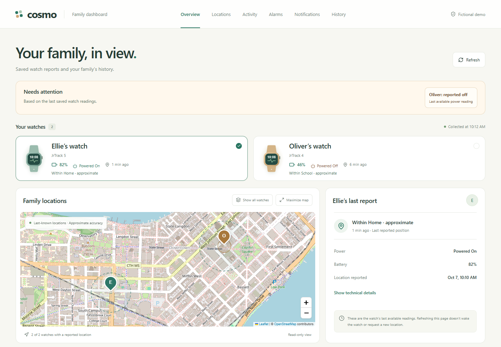
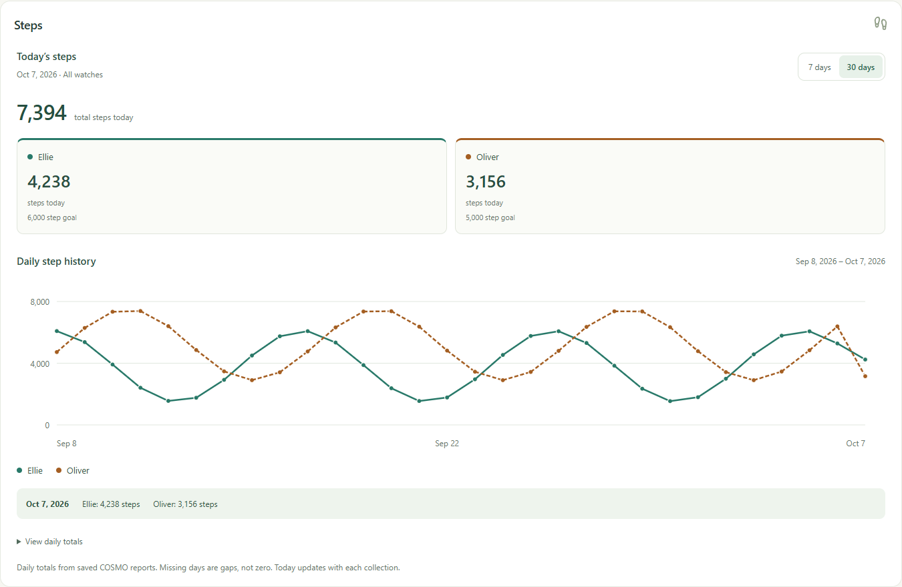
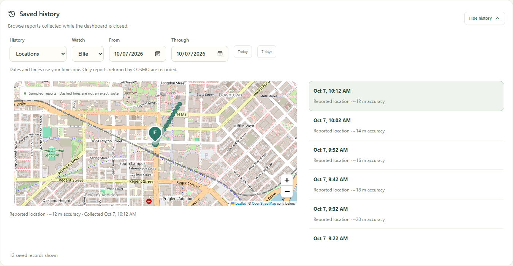

# COSMO API explorer

An unofficial CLI, dashboard, and API reference for COSMO JrTrack watches using the FiLIP mobile API. Provided for informational and educational purposes; this project is not affiliated with or endorsed by COSMO or FiLIP. Endpoint availability and behavior may vary by account and device.

## Quickstart

Clone once, then choose the CLI or Docker dashboard:

```sh
git clone https://github.com/ryancbutler/cosmo-api-explorer.git
cd cosmo-api-explorer
```

### Python CLI

Requires Python 3.11 or newer. In Windows PowerShell, from the repository root:

```powershell
python -m venv .venv
.venv/Scripts/python.exe -m pip install -r cli/requirements.txt

$cosmoPrivateDir = Join-Path $env:LOCALAPPDATA 'cosmo-api-explorer'
$cosmoEnvPath = Join-Path $cosmoPrivateDir '.env'
New-Item -ItemType Directory -Path $cosmoPrivateDir -Force | Out-Null
if (-not (Test-Path -LiteralPath $cosmoEnvPath)) {
    Copy-Item -LiteralPath cli/.env.example -Destination $cosmoEnvPath
}
```

Privately edit that external `.env` and set `COSMO_EMAIL` and `COSMO_PASSWORD`
to your COSMO parent-account credentials. `COSMO_DEVICE_ID` is optional. Then:

```powershell
.venv/Scripts/python.exe cli/cosmo.py --help
.venv/Scripts/python.exe cli/cosmo.py devices
```

On Linux/macOS, use `python3 -m venv .venv` and `.venv/bin/python` for the pip
and CLI commands. Put credentials in `~/.local/share/cosmo-api-explorer/.env`;
the [CLI credentials guide](cli/README.md#credentials-and-env) includes safe
template-copy commands for both platforms and custom file locations.

`devices` authenticates and reads last-known watch reports without waking the
watches. Tokens stay outside the repository. Help needs no credentials. See
[CLI commands](cli/README.md) and [agent installation from scratch](cli/AI_SETUP.md).

### Docker dashboard

Requires Docker with Compose and Linux containers. No host Python or Node.js
installation is needed. From the repository root in Windows PowerShell:

```powershell
$cosmoPrivateDir = Join-Path $env:LOCALAPPDATA 'cosmo-api-explorer'
$cosmoDockerEnv = Join-Path $cosmoPrivateDir 'dashboard.env'
New-Item -ItemType Directory -Path $cosmoPrivateDir -Force | Out-Null
if (-not (Test-Path -LiteralPath $cosmoDockerEnv)) {
    Copy-Item -LiteralPath dashboard/deploy/.env.example -Destination $cosmoDockerEnv
}
```

Privately edit `dashboard.env` to set `COSMO_EMAIL`, `COSMO_PASSWORD`,
`DASHBOARD_USERNAME`, and `DASHBOARD_PASSWORD`. The dashboard username/password
are your browser login, separate from the COSMO account credentials.

```powershell
docker compose --env-file "$cosmoDockerEnv" -f dashboard/deploy/compose.yaml up -d --build
```

Open [http://localhost:8080](http://localhost:8080) and enter your dashboard
username/password in the browser prompt.

On Linux/macOS, copy the template to a private file outside the checkout (without
overwriting an existing file), restrict its permissions, and supply its path:

```sh
docker compose --env-file /private/cosmo-dashboard.env -f dashboard/deploy/compose.yaml up -d --build
```

Choose these settings in the private env file before starting:

| Setting | Behavior |
| --- | --- |
| `COSMO_DATA_MODE=history` (default) | Collect reports every five minutes; keep SQLite history in a persistent Docker volume and show historical panels. |
| `COSMO_DATA_MODE=realtime` | Read latest COSMO reports directly; no database access, collection, or historical panels. |
| `DASHBOARD_AUTH_ENABLED=true` (default) | Require the separate dashboard browser login. |
| `DASHBOARD_AUTH_ENABLED=false` | Open pages/read APIs without login; dashboard credentials may be omitted. Use behind your own access controls or on a trusted private network. |

After changing settings, rerun `up -d --force-recreate` with the same env file
and Compose path. Stop with `down` using those same arguments; omit `-v` to
preserve history. The port binds to localhost; remote access needs your private
HTTPS proxy or VPN. This runs the bundled single-instance Wrangler/Miniflare
runtime. See [deployment details and limitations](dashboard/docs/DEPLOYMENT.md)
for storage, backups, Kubernetes, and the Sites installation prompt. Starting
Docker does not modify an existing hosted Site.

## Sample dashboard

These screenshots show the local `/demo` page with fictional watches, locations, and history. They contain no live account or family data.

**Overview:** sample watch readings, reported power and battery, and approximate locations.



**Steps:** daily totals and a 30-day comparison for the demo watches.



**Saved history:** sample location reports with timestamps and approximate accuracy.



## Repository

| Folder | Contents |
| --- | --- |
| [dashboard/](dashboard/README.md) | Private dashboard, collector, history, demo, tests, and deployment templates |
| [api/](api/README.md) | API reference, evidence notes, and importable OpenAPI 3 (Swagger) contract |
| [cli/](cli/README.md) | Python CLI, dependencies, and mocked/read-only tests |

Start with [CLI agent setup](cli/AI_SETUP.md) for a repeatable setup without personal data. Commands now run as `python cli/cosmo.py ...`; Python dependencies are in `cli/requirements.txt`.

Credentials, token caches, response captures, chat backups, local databases, and personal deployment identities belong outside this checkout. The CLI defaults to an OS-local data directory. Dashboard fixtures are fictional; hosted account data remains private runtime data.

Offline checks from the repository root:

```powershell
python -m py_compile cli/cosmo.py
python -m unittest discover -s cli/tests -v
cd dashboard
npm test
npm run typecheck
python tests/trigger_test.py
```

Live tests require an explicit credentialed run. Every CLI watch mutation requires `--yes`; that flag does not authorize an AI agent to issue live writes without the user's approval.
